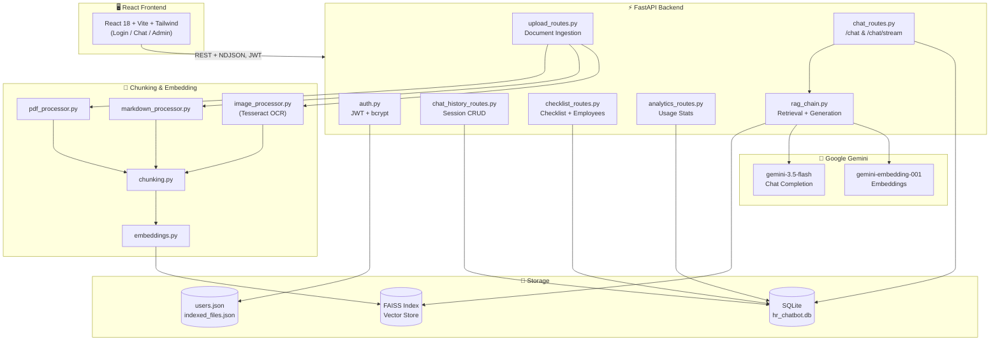

# 🏢 Arch Assistant — RAG-Based HR Chatbot

**An intelligent, document-grounded HR assistant built for Arcana Info**


---

*Employees ask natural-language questions about company policies, leave, benefits, and IT setup — and get accurate answers grounded strictly in uploaded HR documents, with source citations.*

---

## 📖 Table of Contents

- [Overview](#-overview)
- [Key Features](#-key-features)
- [Architecture](#-architecture)
- [Tech Stack](#-tech-stack)
- [Project Structure](#-project-structure)
- [Getting Started](#-getting-started)
- [API Endpoints](#-api-endpoints)
- [Team](#-team)
- [License](#-license)

---

## 🔍 Overview

**Arch Assistant** is a Retrieval-Augmented Generation (RAG) chatbot designed for internal HR operations at Arcana Info. It enables employees to get instant, accurate answers from company policy documents without needing to manually search through PDFs, markdown files, or scanned images.

The system features a complete RAG pipeline — document ingestion, intelligent chunking, vector embedding, hybrid retrieval (vector + BM25 keyword search), and LLM-powered answer generation with built-in hallucination controls. HR administrators have access to a dedicated dashboard for managing documents, monitoring usage analytics, tracking employee onboarding progress, and viewing the employee roster.

---

## ✨ Key Features

### 💬 Employee Chat Interface
- **Real-time RAG answers** grounded in uploaded company documents with source citations.
- **Streaming responses** — ChatGPT-style token-by-token answer delivery via NDJSON.
- **Multi-turn conversation memory** — follow-up questions are understood in context.
- **Persistent chat history** — sessions are saved per employee and can be resumed.
- **Smart caching** — repeated questions are served instantly without hitting the LLM API.
- **Onboarding checklist** — guided first-day tasks with one-click "Ask" to chat about each item.

### 🛡️ HR Admin Dashboard
- **Document management** — upload PDFs, Markdown, and images (PNG/JPG/JPEG); delete individual files or reset the entire index.
- **Usage analytics** — total questions, weekly activity trends (Recharts), most-cited documents, answer success rates.
- **Employee roster** — view all registered employees with onboarding checklist completion percentages.
- **Employee chat viewer** — HR can view individual employee chat transcripts (read-only).
- **Onboarding checklist management** — add/remove onboarding tasks that all employees see.

### 🧠 RAG Pipeline & Hallucination Controls
- **Hybrid search** — FAISS vector similarity + BM25 keyword retrieval for comprehensive coverage.
- **MMR re-ranking** — Maximal Marginal Relevance ensures diverse, non-redundant context chunks.
- **Similarity threshold gate** — off-topic questions are rejected before reaching the LLM.
- **Lexical groundedness check** — a post-generation heuristic verifies the answer's words overlap with retrieved context.
- **Meta-question detection** — "which documents do you have?" is answered from the registry, not hallucinated.
- **Non-English answer handling** — groundedness checks are skipped for Urdu/Roman Urdu outputs to prevent false rejections.

### 🔐 Authentication & Authorization
- **JWT-based auth** — HS256 tokens with 12-hour expiry, role-based route protection.
- **Employee self-signup** — password policy enforcement (8+ chars, ≥1 letter, ≥1 digit).
- **Fixed HR account** — single admin account configured via `.env`, no self-registration.
- **Role-based routing** — employees see the Chat view, HR sees the Admin dashboard.

---

## 🏗️ Architecture



---

## 🛠️ Tech Stack

| Layer | Technology | Purpose |
|---|---|---|
| **Backend** | Python, FastAPI, Uvicorn | REST API with async support, auto-generated OpenAPI docs |
| **LLM** | Google Gemini (`gemini-3.5-flash`) | Answer generation with low temperature (0.2) for accuracy |
| **Embeddings** | Google Gemini (`gemini-embedding-001`) | Document and query embedding for semantic search |
| **Vector Store** | FAISS (local, file-based) | Fast similarity search — no external vector DB required |
| **Keyword Search** | BM25 (`rank_bm25`) | Hybrid search complement for exact term/acronym matching |
| **Chunking** | LangChain Text Splitters | `RecursiveCharacterTextSplitter` + `MarkdownHeaderTextSplitter` |
| **OCR** | Tesseract via `pytesseract` | Text extraction from scanned images with preprocessing |
| **PDF Extraction** | pdfplumber | Reliable text extraction from office-generated PDFs |
| **Database** | SQLite via SQLAlchemy | Chat history, analytics logs, onboarding checklist |
| **Auth** | JWT (PyJWT) + bcrypt | Stateless token auth with role-based access control |
| **Frontend** | React 18 + Vite + Tailwind CSS | Modern SPA with responsive design and animations |
| **Charts** | Recharts | Analytics visualizations in the HR dashboard |

---

## 📁 Project Structure

```
Internship-Project/
├── backend/                        # FastAPI application
│   ├── main.py                     # App entrypoint, router registration, CORS, seed
│   ├── auth.py                     # JWT + bcrypt + users.json auth logic
│   ├── auth_routes.py              # POST /auth/signup, POST /auth/login
│   ├── database.py                 # SQLAlchemy models (5 tables) + engine
│   ├── rag_chain.py                # RAG pipeline — retrieval + generation + caching
│   ├── chat_routes.py              # POST /chat, POST /chat/stream
│   ├── chat_history_routes.py      # Session/message CRUD
│   ├── upload_routes.py            # Document upload/delete/reset/list
│   ├── checklist_routes.py         # Onboarding checklist + employee roster
│   ├── analytics_routes.py         # GET /analytics/summary
│   ├── seed_demo_data.py           # One-off script to populate demo data
│   └── requirements.txt            # Pinned Python dependencies
│
├── chunking-embedding/             # Document processing pipeline
│   ├── pdf_processor.py            # PDF text extraction (pdfplumber)
│   ├── markdown_processor.py       # Markdown file reader
│   ├── image_processor.py          # OCR with preprocessing (pytesseract)
│   ├── chunking.py                 # Text splitting strategies
│   └── embeddings.py               # FAISS index create/update/delete
│
├── frontend/                       # React SPA (Vite + Tailwind)
│   ├── src/
│   │   ├── App.jsx                 # Role-based routing (Login → Chat | Admin)
│   │   ├── lib/apiClient.js        # Backend API client (one function per route)
│   │   ├── pages/                  # LoginPage, ChatPage, AdminPage
│   │   └── components/             # Sidebar, ChatMessage, DocumentsTab,
│   │                               # AnalyticsTab, EmployeesTab, ChecklistTab, etc.
│   ├── tailwind.config.js          # Design system tokens
│   └── package.json                # Node dependencies
│
├── docs/                           # Documentation
│   ├── ARCHITECTURE.md             # System architecture deep-dive
│   ├── SPECS.md                    # Full technical specification
│   └── api_contract.md             # Endpoint reference
│
├── testing/                        # Test files
├── SETUP.md                        # Step-by-step setup guide
└── .gitignore
```

---

## 🚀 Getting Started

### Prerequisites

| Tool | Version | Check |
|---|---|---|
| Python | 3.11+ | `python --version` |
| Node.js | 18+ | `node --version` |
| Git | any recent | `git --version` |
| Tesseract OCR | any recent | [Windows installer](https://github.com/UB-Mannheim/tesseract/wiki) |

### 1. Clone the Repository

```bash
git clone https://github.com/ALI-Z-Ather/Internship-Project.git
cd Internship-Project
```

### 2. Backend Setup

```bash
cd backend
python -m venv venv
venv\Scripts\activate          # Windows
pip install -r requirements.txt
```

Create a `.env` file inside `backend/`:

```env
GEMINI_API_KEY=your_google_gemini_api_key
FAISS_INDEX_PATH=faiss_index
JWT_SECRET=any_random_long_string
HR_EMAIL=hr@yourcompany.com
HR_PASSWORD_HASH=
HOST=127.0.0.1
PORT=8000
```

> **Note:** Get a free `GEMINI_API_KEY` from [Google AI Studio](https://aistudio.google.com/apikey). Generate `HR_PASSWORD_HASH` with:
> ```bash
> python -c "from auth import hash_password; print(hash_password('your_hr_password'))"
> ```

Start the backend:

```bash
uvicorn main:app --reload
```

Backend runs at `http://127.0.0.1:8000` — verify at `http://127.0.0.1:8000/docs`.

### 3. Frontend Setup

Open a **new terminal**:

```bash
cd frontend
npm install
npm run dev
```

Frontend opens at `http://localhost:5173`.

---

## 📡 API Endpoints

| Method | Endpoint | Auth | Description |
|---|---|---|---|
| `POST` | `/auth/signup` | — | Employee registration |
| `POST` | `/auth/login` | — | Login (employee or HR) |
| `POST` | `/chat` | Optional | Ask a question (RAG answer) |
| `POST` | `/chat/stream` | Optional | Streaming RAG answer (NDJSON) |
| `GET` | `/chat/sessions` | Login | List user's chat sessions |
| `GET` | `/chat/sessions/{id}/messages` | Login | Get session messages |
| `DELETE` | `/chat/sessions/{id}` | Login | Delete a chat session |
| `POST` | `/upload-documents` | HR | Upload documents (PDF/MD/PNG/JPG) |
| `GET` | `/indexed-documents` | — | List indexed documents |
| `DELETE` | `/documents/{filename}` | HR | Delete a single document |
| `DELETE` | `/reset-documents` | HR | Clear all documents |
| `GET` | `/checklist/items` | Login | List onboarding tasks |
| `POST` | `/checklist/items` | HR | Create onboarding task |
| `DELETE` | `/checklist/items/{id}` | HR | Delete onboarding task |
| `GET` | `/checklist/progress` | Login | Get user's checklist progress |
| `POST` | `/checklist/progress/{id}` | Login | Toggle checklist item |
| `GET` | `/employees` | HR | Employee roster with completion % |
| `GET` | `/employees/{email}/sessions` | HR | View employee's chat sessions |
| `GET` | `/analytics/summary` | HR | Dashboard analytics data |

---

## 👥 Team & Contributions

This project was developed as part of an internship project at **Arcana Info**.

- **Abubakr Chaudhry**: Backend Development (FastAPI, Authentication, SQLite Database, RAG Pipeline, API Routes)
- **Ali Ather**: Frontend Development (React UI, Tailwind CSS Design System, Admin Dashboard & Controls)
- **Muhammad Saad**: Chunking & Embeddings (Document Processing, Text Splitting, Vector Embedding, FAISS Indexing & OCR)
- **Sabahat Liaqat**: Testing (System & API Testing)

---

## 📝 License

This project was developed for educational and internship purposes at Arcana Info.
