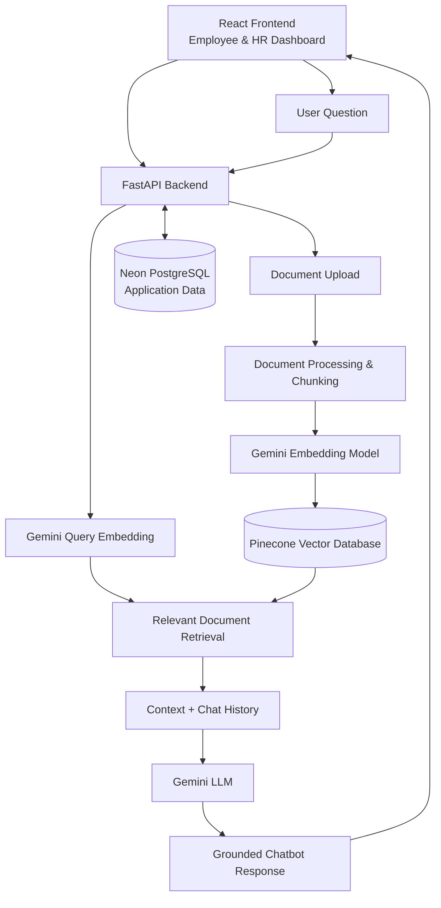

# 🏢 Arch Assistant — AI-Powered HR Chatbot

**A document-grounded HR assistant developed for Arcana Info using Retrieval-Augmented Generation (RAG).**


---

## 📌 Overview

**Arch Assistant** is an AI-powered HR chatbot developed for Arcana Info. It helps employees access company information by asking natural-language questions about HR policies, leave entitlements, employee benefits, onboarding, and IT procedures.

The application uses Retrieval-Augmented Generation (RAG) to retrieve relevant information from uploaded company documents and generate context-grounded answers using Google Gemini.

It also provides a dedicated HR Admin Dashboard for document management, employee monitoring, onboarding checklist management, and usage analytics.

## ✨ Key Features

### 💬 Employee Chat

- Ask questions about company policies and HR procedures.
- Receive AI-generated answers grounded in uploaded HR documents.
- Stream responses using NDJSON.
- Maintain persistent chat history and conversation sessions.
- Ask follow-up questions using conversation context.
- View source documents associated with retrieved answers.
- Access employee onboarding checklists.

### 🛡️ HR Admin Dashboard

- Upload and manage HR documents.
- View indexed documents.
- Delete individual documents.
- Manage employee onboarding checklist items.
- View registered employees.
- Monitor employee chat sessions.
- Access usage analytics and activity statistics.

### 🧠 Retrieval-Augmented Generation (RAG)

- Extract text from uploaded documents.
- Process and split documents into chunks.
- Generate document and query embeddings using Gemini.
- Store and retrieve vectors through Pinecone.
- Retrieve relevant document chunks using similarity search.
- Generate context-grounded responses using Gemini.
- Apply similarity thresholds and groundedness checks.
- Support PDF, Markdown, and image-processing workflows.

## 🏗️ System Architecture

The application uses Gemini for both embeddings and response generation, while Pinecone handles vector storage and retrieval. Neon PostgreSQL manages persistent application data.



## 🛠️ Technology Stack

| Layer | Technology | Purpose |
|---|---|---|
| Backend | Python, FastAPI | API development and backend services |
| Frontend | React 18, Vite | Interactive user interface |
| Styling | Tailwind CSS | Responsive UI design |
| LLM | Google Gemini | Context-grounded answer generation |
| Embeddings | Gemini Embedding 001 | Document and query embeddings |
| Vector Database | Pinecone | Vector storage and semantic retrieval |
| Application Database | Neon PostgreSQL | Persistent application data |
| ORM | SQLAlchemy | Database operations |
| Authentication | JWT, bcrypt | Authentication and password security |
| Document Processing | LangChain, pdfplumber | Document processing and text extraction |
| OCR | Tesseract, pytesseract | Image-based text extraction |
| Charts | Recharts | Dashboard analytics |
| API Server | Uvicorn | FastAPI application server |

## 📂 Project Structure

```text
HR-Chatbot/
│
├── backend/
│   ├── chunking_embedding/
│   │   ├── chunking.py
│   │   ├── embeddings.py
│   │   ├── image_processor.py
│   │   ├── markdown_processor.py
│   │   └── pdf_processor.py
│   │
│   ├── routers/
│   │   ├── analytics_routes.py
│   │   ├── auth_routes.py
│   │   ├── chat_history_routes.py
│   │   ├── chat_routes.py
│   │   ├── checklist_routes.py
│   │   └── upload_routes.py
│   │
│   ├── docs/
│   ├── tests/
│   ├── uploads/
│   ├── auth.py
│   ├── database.py
│   ├── main.py
│   ├── rag_chain.py
│   ├── migrate_faiss_to_pinecone.py
│   ├── migrate_sqlite_to_neon.py
│   ├── pyproject.toml
│   ├── requirements.txt
│   └── uv.lock
│
├── frontend/
│   ├── public/
│   ├── src/
│   │   ├── components/
│   │   ├── lib/
│   │   ├── pages/
│   │   ├── App.jsx
│   │   └── main.jsx
│   ├── package.json
│   ├── package-lock.json
│   ├── tailwind.config.js
│   └── vite.config.js
│
├── .gitignore
├── README.md
├── package.json
├── package-lock.json
└── neon.ts
```

## 🚀 Getting Started

### Prerequisites

- Python 3.12 or later
- Node.js and npm
- Git
- UV package manager
- Google Gemini API key
- Pinecone account and API key
- Neon PostgreSQL database

### 1. Clone the Repository

```bash
git clone https://github.com/sabahatliaqat/HR-Chatbot.git
cd HR-Chatbot
```

### 2. Backend Setup

Navigate to the backend directory:

```bash
cd backend
```

Install dependencies:

```bash
uv sync
```

Create a `.env` file inside the `backend` directory:

```env
GEMINI_API_KEY=your_gemini_api_key

DATABASE_URL=your_neon_postgresql_connection_string

PINECONE_API_KEY=your_pinecone_api_key
PINECONE_INDEX_NAME=hr-chatbot-gemini

JWT_SECRET=your_secure_jwt_secret

HR_EMAIL=your_hr_email
HR_PASSWORD_HASH=your_hr_password_hash
```

Replace the example values with your actual credentials.

**Important:** Never upload `.env` files, API keys, passwords, or database credentials to GitHub.

Start the backend server:

```bash
uv run uvicorn main:app --host 127.0.0.1 --port 8010 --reload
```

Backend URL:

```text
http://127.0.0.1:8010
```

Interactive API documentation:

```text
http://127.0.0.1:8010/docs
```

### 3. Frontend Setup

Open another terminal and navigate to the frontend directory:

```bash
cd frontend
```

Install dependencies:

```bash
npm install
```

Start the development server:

```bash
npm run dev
```

Open the local Vite URL displayed in your terminal.

**Note:** The current frontend API client is configured to communicate with the backend at `http://127.0.0.1:8010`.

## 🗄️ Database and Vector Storage

### Neon PostgreSQL

Neon PostgreSQL is used for persistent application data, including:

- Chat sessions and messages.
- Employee information.
- Onboarding checklist items.
- Employee progress.
- QA logs and analytics records.

SQLAlchemy is used for database operations.

### Pinecone Vector Database

Pinecone stores document embeddings and supports semantic retrieval of relevant HR document chunks.

Current index configuration:

| Configuration | Value |
|---|---|
| Index Name | `hr-chatbot-gemini` |
| Embedding Model | `models/gemini-embedding-001` |
| Dimensions | `3072` |
| Similarity Metric | Cosine |

### Google Gemini

Google Gemini is used for two main tasks:

1. **Embeddings:** Converts document chunks and user questions into vector representations.
2. **Answer Generation:** Generates responses using the relevant information retrieved from Pinecone.

## 🔌 API Documentation

The backend exposes REST API routes for:

- Employee authentication and registration.
- Chat and streaming responses.
- Chat history and sessions.
- HR document upload and management.
- Employee onboarding checklists.
- Employee roster management.
- HR dashboard analytics.

Explore the complete API documentation through FastAPI Swagger UI:

```text
http://127.0.0.1:8010/docs
```

## 👥 Team & Contributions

Developed as part of an internship project at **Arcana Info**.

- **Abubakr Chaudhry:** Backend Development, Authentication, API Routes and RAG Pipeline.
- **Ali Ather:** Frontend Development, React UI and HR Admin Dashboard.
- **Muhammad Saad:** Document Processing, Chunking, Embeddings and OCR.
- **Sabahat Liaqat:** System Testing, API Testing and Deployment Support.

## 🔒 Security Notes

- Keep environment variables and credentials in `.env` files.
- Never expose API keys or database connection strings.
- Use secure JWT secrets.
- Restrict HR administrative endpoints to authorized users.
- Do not commit local dependency folders or generated build files.

---

**Project:** Arch Assistant — AI-Powered HR Chatbot
**Organization:** Arcana Info
**Repository:** [HR-Chatbot](https://github.com/sabahatliaqat/HR-Chatbot)