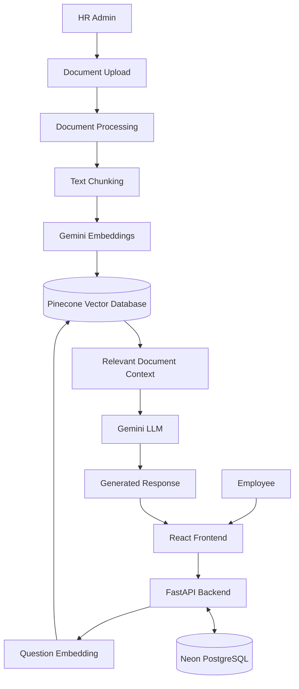

# 🏢 Arch Assistant — AI-Powered HR Chatbot

**A document-grounded HR assistant built for Arcana Info using Retrieval-Augmented Generation (RAG).**


## 📌 Project Overview

**Arch Assistant** is an AI-powered HR chatbot developed for Arcana Info. It helps employees and HR administrators access HR-related information through natural-language conversations.

The chatbot uses Retrieval-Augmented Generation (RAG) to retrieve relevant information from uploaded company documents and generate context-aware responses using Google's Gemini models.

The application includes an employee-facing chat interface and an HR administration dashboard for document management, employee information, onboarding checklists, and analytics.

## ✨ Key Features

### Employee Features
- Ask HR-related questions in natural language.
- Receive answers grounded in uploaded company documents.
- Access chat history.
- View and manage onboarding checklist items.
- Receive streamed chatbot responses.

### HR Admin Features
- Secure HR administrator login.
- Upload and manage HR documents.
- Manage employee information.
- Create and manage onboarding checklist items.
- View dashboard analytics and chatbot activity.
- Monitor employee onboarding progress.

### AI and RAG Features
- Document processing and text extraction.
- Text chunking and embedding generation.
- Semantic search using Pinecone.
- Context-aware response generation using Gemini.
- Retrieval-based answers using relevant document content.
- Conversation context for follow-up questions.

## 🏗️ System Architecture

Arch Assistant follows a Retrieval-Augmented Generation architecture.

### Document Ingestion Flow

1. HR uploads company documents.
2. The backend extracts and processes document content.
3. Text is divided into smaller chunks.
4. Gemini generates vector embeddings.
5. Embeddings are stored in Pinecone for retrieval.

### Question and Answer Flow

1. An employee submits a question.
2. The question is converted into an embedding using the same embedding model.
3. Pinecone retrieves relevant document chunks.
4. Retrieved context is passed to the Gemini language model.
5. Gemini generates a context-aware response.
6. The response is returned to the frontend.

### Architecture Diagram



## 🛠️ Technology Stack

| Category | Technologies |
|---|---|
| Frontend | React, Vite, Tailwind CSS, JavaScript |
| Backend | Python, FastAPI |
| AI Model | Google Gemini |
| Embeddings | `models/gemini-embedding-001` |
| RAG | LangChain, Retrieval-Augmented Generation |
| Vector Database | Pinecone |
| Application Database | Neon PostgreSQL |
| Authentication | JWT, bcrypt |
| Document Processing | PDF processing, Markdown processing, OCR |
| API Testing | FastAPI Swagger UI |

## 📂 Project Structure

```text
HR-Chatbot/
│
├── backend/
│   ├── chunking_embedding/
│   │   ├── chunking.py
│   │   ├── embeddings.py
│   │   ├── image_processor.py
│   │   ├── markdown_processor.py
│   │   └── pdf_processor.py
│   │
│   ├── routers/
│   │   ├── analytics_routes.py
│   │   ├── auth_routes.py
│   │   ├── chat_history_routes.py
│   │   ├── chat_routes.py
│   │   ├── checklist_routes.py
│   │   └── upload_routes.py
│   │
│   ├── docs/
│   ├── uploads/
│   ├── auth.py
│   ├── database.py
│   ├── main.py
│   ├── rag_chain.py
│   ├── pyproject.toml
│   └── uv.lock
│
├── frontend/
│   ├── public/
│   └── src/
│       ├── components/
│       ├── lib/
│       ├── pages/
│       ├── App.jsx
│       └── main.jsx
│
├── README.md
└── .gitignore
```

## 🚀 Getting Started

### Prerequisites

Make sure you have the following installed:

- Python 3.12 or higher
- Node.js and npm
- [uv](https://docs.astral.sh/uv/)
- Git

You will also need API credentials for Google Gemini and Pinecone, along with a Neon PostgreSQL database.

### 1. Clone the Repository

```bash
git clone https://github.com/sabahatliaqat/HR-Chatbot.git
cd HR-Chatbot
```

### 2. Backend Setup

Navigate to the backend directory:

```powershell
cd backend
```

Install Python dependencies:

```powershell
uv sync
```

Create a `.env` file inside the `backend` directory and configure the following environment variables:

```env
GEMINI_API_KEY=your_gemini_api_key

PINECONE_API_KEY=your_pinecone_api_key
PINECONE_INDEX_NAME=hr-chatbot-gemini

DATABASE_URL=your_neon_postgresql_connection_string

JWT_SECRET=your_jwt_secret

HR_EMAIL=your_hr_email
HR_PASSWORD_HASH=your_hr_password_hash
```

Replace the example values with your actual credentials. Never commit your `.env` file or expose API keys and database credentials.

Start the backend server:

```powershell
uv run uvicorn main:app --host 127.0.0.1 --port 8010 --reload
```

Backend API:

```text
http://127.0.0.1:8010
```

Swagger API documentation:

```text
http://127.0.0.1:8010/docs
```

### 3. Frontend Setup

Open another terminal and navigate to the frontend directory:

```powershell
cd frontend
```

Install dependencies:

```powershell
npm install
```

Start the frontend:

```powershell
npm run dev
```

Open the local URL provided by Vite in your browser.

## 🗄️ Database and Vector Storage

Arch Assistant uses two separate storage systems.

### Neon PostgreSQL

Neon PostgreSQL stores application-related data, including:

- Chat sessions and messages.
- Employee information.
- Onboarding checklist items.
- Employee onboarding progress.
- Chatbot question-and-answer logs.
- Analytics-related records.

### Pinecone

Pinecone stores document embeddings and supports semantic retrieval for the RAG pipeline.

Current vector index configuration:

| Setting | Value |
|---|---|
| Index Name | `hr-chatbot-gemini` |
| Embedding Model | `models/gemini-embedding-001` |
| Dimensions | 3072 |
| Similarity Metric | Cosine |
| Cloud Provider | AWS |
| Region | us-east-1 |

## 🔐 Security

- HR administrative routes require authentication.
- JWT is used for authenticated sessions.
- Password hashing is handled using bcrypt.
- Environment variables are used for sensitive credentials.
- Database and API credentials should never be committed to GitHub.

## 📚 API Documentation

The backend provides API endpoints for authentication, chat functionality, chat history, document management, onboarding checklists, and analytics.

For the complete list of available routes and their request/response details, run the backend and visit:

`http://127.0.0.1:8010/docs`

## 👩‍💻 Development Journey & Project Ownership

Arch Assistant was initially developed as a collaborative project by a **five-member team** during our internship at **Arcana Info**.

During the initial development phase, team members worked collaboratively on different parts of the application, including frontend development, backend development, document processing, RAG implementation, and testing.

After the initial team phase, I took over the project and am now **solely handling its ongoing development and management**.

My current responsibilities include:

- Further development and implementation of new features.
- Improving the existing RAG pipeline and chatbot functionality.
- Backend and frontend enhancements.
- Database and vector storage management.
- System testing and API testing.
- Debugging, maintenance, and deployment.

**The project began as a team effort, and I am now independently responsible for its continued development, improvements, and maintenance.**

## 👤 Current Project Maintainer

**Sabahat Liaqat**

AI Engineer | Generative AI | RAG | Python | LLMs

GitHub: [sabahatliaqat](https://github.com/sabahatliaqat)

---

**Project:** Arch Assistant — AI-Powered HR Chatbot  
**Organization:** Arcana Info  
**Current Development:** Independently maintained and developed
