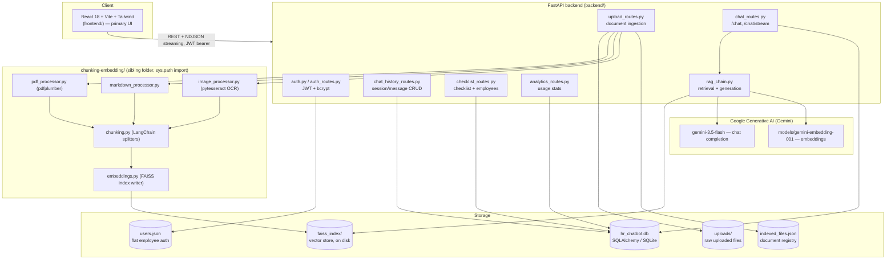

# Arch Assistant — Architecture

**What it is:** "Arch Assistant" is a RAG-based internal HR chatbot built for
a company called Arcana Info. Employees ask natural-language questions about
leave, benefits, dress code, IT setup, onboarding, etc. and get answers
grounded strictly in HR documents the company has uploaded (PDF, Markdown, or
scanned images). HR gets a separate admin dashboard to manage those
documents, see usage analytics, manage the onboarding checklist, and see a
roster of employees with their onboarding progress.

**History:** started as a 3-person university/internship project
(`chunking-embedding/`, `backend/`, `ui/` — a Streamlit UI). Later extended
solo with a full React frontend (`frontend/`), JWT authentication, and a
SQLite persistence layer for chat history/analytics/checklist. The React
frontend was originally a separate standalone repo, later merged into this
project folder. The original Streamlit UI (`ui/`) was retired and removed
once the React frontend covered all of its functionality.

---

## 1. High-level system diagram



---

## 2. Tech stack — what, and why

| Layer | Technology | Why this choice |
|---|---|---|
| Backend framework | **FastAPI** | Async-friendly, automatic OpenAPI/Swagger docs, Pydantic request/response validation with minimal boilerplate. |
| LLM + embeddings | **Google Gemini** (`gemini-3.5-flash` chat, `models/gemini-embedding-001` embeddings) via `langchain-google-genai` | Free tier available for a student/internship-scale project; LangChain wrapper gives a consistent interface if the model is swapped later. **Volatile** — model name and quota have both changed repeatedly (see SPECS.md → Known Limitations). |
| Vector store | **FAISS** (`langchain_community.vectorstores.FAISS`), saved to a local folder | No external vector DB service to run/pay for — a local file-based index is sufficient at this project's document volume. |
| Keyword search | **BM25** (`rank_bm25` via `langchain_community.retrievers.BM25Retriever`) | Folded in alongside vector search (hybrid search) to catch exact terms/acronyms that embedding similarity sometimes misses. |
| Chunking | **LangChain text splitters** (`RecursiveCharacterTextSplitter`, `MarkdownHeaderTextSplitter`) | Off-the-shelf, well-tested splitting logic instead of hand-rolled logic; Markdown gets heading-aware splitting so chunks keep their section context. |
| OCR | **pytesseract** wrapping the **Tesseract** binary | Free, local, no per-call API cost — needed since some HR content is only available as screenshots. Requires the Tesseract binary installed on the OS separately from the pip package. |
| PDF text extraction | **pdfplumber** | Reliable plain-text extraction from typical office-generated PDFs. |
| Relational data | **SQLite via SQLAlchemy** (`database.py`, one file: `hr_chatbot.db`) | Chat history, per-employee checklist progress, and QA logs are inherently relational (sessions → many messages, employees → many checklist items) — a good fit for a real (if lightweight) SQL schema. Deliberately **not** used for employee auth (see below). |
| Employee auth | **Flat `users.json` file** + bcrypt password hashes | A deliberate scope decision, not tech debt: employee accounts are simple key→hash lookups with no relations, so a JSON file avoids adding SQL-table complexity where it buys nothing. |
| HR auth | **Single fixed account via `.env`** (`HR_EMAIL`, `HR_PASSWORD_HASH`) | There is intentionally no HR self-signup flow — one company, one HR account, configured by whoever deploys the backend. |
| Auth tokens | **JWT** (`PyJWT`), `HS256`, 12-hour expiry | Stateless — no server-side session store needed; the token's `role` claim (`"employee"` / `"hr"`) drives all route-level authorization. |
| Primary frontend | **React 18 + Vite + Tailwind CSS** (`frontend/`) | Modern SPA stack: fast Vite dev server/HMR, Tailwind for the design system, Recharts for Analytics charts. |
| Charts | **Recharts** | React-native charting library used in `AnalyticsTab.jsx`. |
| Markdown rendering | **react-markdown** | Renders Gemini's `**bold**`/list-formatted answers properly in chat bubbles instead of showing literal asterisks. |

---

## 3. Folder structure

```
hr-chatbot-project/
├── backend/                    # FastAPI app — the only backend process
│   ├── main.py                 # app entrypoint, router registration, CORS, checklist seed
│   ├── auth.py                 # JWT + bcrypt + users.json read/write (not a route file)
│   ├── auth_routes.py          # POST /auth/signup, POST /auth/login
│   ├── database.py             # SQLAlchemy models + engine + init_db()
│   ├── upload_routes.py        # document upload/delete/reset/list
│   ├── chat_routes.py          # POST /chat, POST /chat/stream
│   ├── chat_history_routes.py  # GET/DELETE under /chat/sessions
│   ├── checklist_routes.py     # checklist items + progress + /employees roster
│   ├── analytics_routes.py     # GET /analytics/summary
│   ├── rag_chain.py            # retrieval + generation pipeline (the "brain")
│   ├── seed_demo_data.py       # one-off script, not imported by the app
│   ├── requirements.txt        # pinned backend dependencies
│   ├── users.json              # flat employee auth store (gitignored data, not code)
│   ├── indexed_files.json      # registry of documents currently in the FAISS index
│   ├── hr_chatbot.db           # SQLite database file
│   ├── faiss_index/            # FAISS vector store (created at runtime)
│   └── uploads/                # raw uploaded source files
│
├── chunking-embedding/         # document-processing pipeline, imported via sys.path
│   ├── pdf_processor.py
│   ├── markdown_processor.py
│   ├── image_processor.py      # OCR (pytesseract)
│   ├── chunking.py             # text splitting
│   └── embeddings.py           # FAISS index create/update/delete
│
├── frontend/                   # React 18 + Vite + Tailwind (primary UI)
│   └── src/
│       ├── App.jsx             # role-based routing: Login → Chat (employee) or Admin (hr)
│       ├── lib/apiClient.js    # one function per backend route
│       ├── pages/               # LoginPage, ChatPage, AdminPage
│       └── components/          # Sidebar, ChatMessage, DocumentsTab, AnalyticsTab,
│                                 # EmployeesTab, ChecklistTab, OnboardingChecklist, etc.
│
├── docs/                        # this documentation
├── project_status.md            # ⚠️ historically inaccurate — see SPECS.md note
├── pending_task.md              # handover notes from an earlier session
└── venv/                        # the Python venv that actually has all deps installed
                                  # (there are also unused .venv/ and .venv-1/ directories)
```

---

## 4. Core data flows

### 4.1 Document ingestion (HR uploads a file)

1. HR uploads PDF/MD/PNG/JPG/JPEG via `DocumentsTab.jsx` → `POST /upload-documents` (HR-only, JWT-protected).
2. `upload_routes.py` saves the raw file to `uploads/`, skips any filename already in `indexed_files.json`.
3. Text extraction dispatches by extension:
   - `.pdf` → `pdf_processor.extract_text_from_pdf` (pdfplumber, page by page)
   - `.md` → `markdown_processor.extract_text_from_markdown` (raw read, headings preserved)
   - `.png/.jpg/.jpeg` → `image_processor.extract_text_from_image` (OCR, with grayscale/contrast/invert/upscale preprocessing — see SPECS.md)
4. Extracted text is chunked (`chunking.py`): Markdown gets heading-aware splitting first, then all chunk types go through `RecursiveCharacterTextSplitter` (1000 chars, 150 overlap).
5. Chunks are embedded and written into the FAISS index (`embeddings.create_or_update_index`), which is created fresh or appended to on disk at `backend/faiss_index/`.
6. `indexed_files.json` registry is updated with size/upload time/status, and `rag_chain.clear_rag_caches()` is called so the in-memory retriever/answer caches don't serve stale results.

### 4.2 Chat / RAG pipeline (employee asks a question)

See `SPECS.md` → "RAG pipeline" for the full step-by-step — summary:

1. Meta-questions ("how many docs do you have") are answered directly from the registry, bypassing vector search entirely.
2. Otherwise: retrieve top-8 candidates by vector similarity → hard-reject (off-topic fallback message) if the best match is too dissimilar → re-rank to a diverse top-4 via MMR → fold in BM25 keyword hits not already present (hybrid search) → build a context block.
3. Repeated questions (no active multi-turn follow-up) are served from an in-process answer cache, skipping retrieval and the LLM call entirely.
4. Gemini generates the answer from a strict system prompt (must come only from context, or say "I cannot find this information").
5. A lexical-overlap groundedness check verifies the answer's substantive words actually appear in the retrieved context — if not, the answer is replaced with the "not found" fallback (no extra LLM call).
6. If the user is logged in, the exchange is persisted to `ChatMessage`/`ChatSession`, and to `QALog` (for Analytics) unless it was a transient system error.
7. `/chat/stream` runs the same pipeline but yields the answer token-by-token as NDJSON.

### 4.3 Auth flow

- **Employee**: signs up via `POST /auth/signup` (email + password, min policy: 8+ chars, ≥1 letter, ≥1 digit) → stored in `users.json` with a bcrypt hash → logs in via `POST /auth/login` with `role: "employee"` → receives a JWT.
- **HR**: no signup route exists. Credentials are fixed via `.env` (`HR_EMAIL`, `HR_PASSWORD_HASH`) → logs in via the same `/auth/login` endpoint with `role: "hr"`.
- The JWT (`{email, role, exp}`, `HS256`, 12h) is sent as `Authorization: Bearer <token>` on every subsequent request. `require_role("hr")` and `require_login` FastAPI dependencies gate routes; `get_optional_user` allows `/chat` to work for both authenticated and (historically) guest callers.
- The frontend also decodes the JWT payload client-side (`apiClient.getStoredUser()`) purely to restore UI state (who's logged in) after a page refresh — every actual request is still re-authorized server-side regardless of what the client believes.

---

## 5. Design decisions worth knowing

- **Two persistence mechanisms, deliberately split.** `users.json` (flat file) for auth, SQLite (`database.py`) for everything relational (chat history, analytics, checklist). This is an intentional scope decision, not an inconsistency to "fix."
- **No semantic caching, only exact-match caching.** The in-process answer cache (`rag_chain._answer_cache`) matches on normalized question text, not semantic similarity — simpler, and directly targets the Gemini free-tier quota problem for literal repeat questions.
- **Guest/"skip login" mode was removed** at the user's request — the app is auth-only now.
- **Not yet deployed anywhere.** Both backend and frontend currently only run as local dev processes (`uvicorn`, `vite`). No Docker, no CI, no hosting configured yet.

For the full endpoint-by-endpoint, table-by-table, and file-by-file specification, see **`SPECS.md`** in this same folder.
